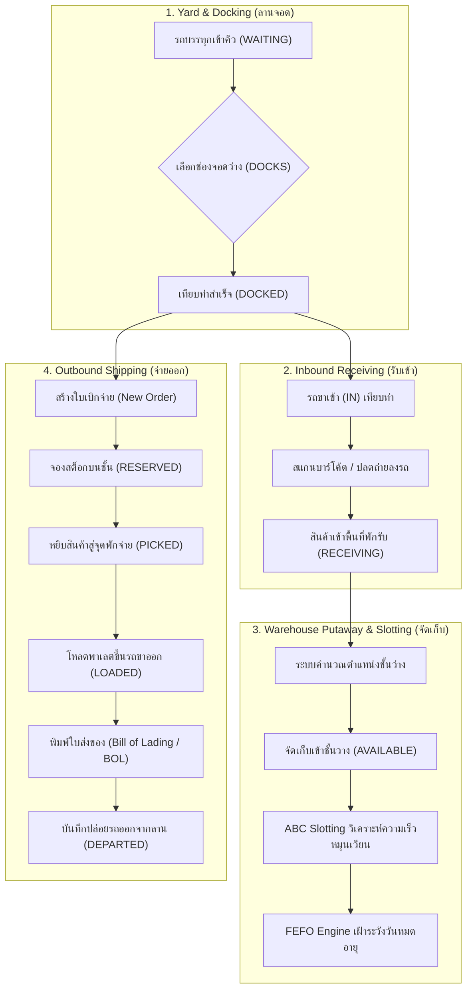

# 🚚 DOCKFLOW WMS: เอกสารคู่มือเตรียมการนำเสนอโครงงาน
**ระบบบริหารจัดการคลังสินค้าและลานเทียบท่าอัจฉริยะ (Smart Warehouse & Yard Management System)**

---

## 📌 สารบัญ (Table of Contents)
1. [บทนำ & ปัญหาที่ระบบเข้ามาแก้ไข (Executive Pitch)](#1-บทนำ--ปัญหาที่ระบบเข้ามาแก้ไข)
2. [Flow การทำงานของระบบแบบ Step-by-Step (Operational Workflow)](#2-flow-การทำงานของระบบแบบ-step-by-step)
3. [เทคโนโลยีและไลบรารีที่ใช้ (Tech Stack & Architecture)](#3-เทคโนโลยีและไลบรารีที่ใช้)
4. [คลังศัพท์เทคนิคโลจิสติกส์ & ฟังก์ชันในโค้ด (Glossary & Code Logic)](#4-คลังศัพท์เทคนิคโลจิสติกส์--ฟังก์ชันในโค้ด)
5. [เจาะลึกโครงสร้างโค้ดและฐานข้อมูล (Code & Database Deep Dive)](#5-เจาะลึกโครงสร้างโค้ดและฐานข้อมูล)
6. [แนวทางตอบคำถามอาจารย์แบบ 100% (Professor Q&A Defense)](#6-แนวทางตอบคำถามอาจารย์แบบ-100)
7. [เช็คลิสต์และสคริปต์สาธิตสด 5 นาที (Live Demo Script)](#7-เช็คลิสต์และสคริปต์สาธิตสด-5-นาที)

---

## 1. บทนำ & ปัญหาที่ระบบเข้ามาแก้ไข

### 🎯 ชื่อโครงงาน
**DOCKFLOW WMS**: ระบบเว็บแอปพลิเคชันบริหารจัดการคลังสินค้าและลานเทียบท่าอัจฉริยะ  
พัฒนาด้วยภาษา **Python** และเฟรมเวิร์ก **Streamlit**

### ⚠️ ปัญหาเดิมของคลังสินค้าทั่วไป (Pain Points)
1. **คอขวดที่ลานเทียบท่า (Yard Bottleneck):** รถบรรทุกเข้ามาออหน้าคลัง ไม่มีการจัดคิว จัดช่องจอดไม่ตรงประเภทงาน (ขาเข้า/ขาออกปนกัน)
2. **การจัดวางสินค้าไร้แบบแผน (Poor Slotting):** สินค้าขายดีหรือหมุนเร็วถูกวางไว้ลึกในคลัง ทำให้พนักงาน Forklift เสียเวลาเดินทางนาน เกิดต้นทุนแฝง
3. **สินค้าหมดอายุค้างสต็อก (Deadstock & Expiry Loss):** ขาดระบบเฝ้าระวังแบบ FEFO ทำให้หยิบของล็อตใหม่ไปส่ง ของล็อตเก่าหมดอายุคาคลัง
4. **ขาดความยืดหยุ่นในข้อมูลกองรถ (Fleet Blindspot):** ไม่ทราบว่ารถคันไหนเป็นของใคร ใครขับ ติดต่อใครได้เมื่อเกิดปัญหา
5. **Human Error จากการจดมือ:** การบันทึกรับ-จ่ายด้วยกระดาษ เกิดข้อผิดพลาดและไม่มีหลักฐานตรวจสอบย้อนกลับ (Traceability)

### 💡 ทางออกของ DOCKFLOW (Key Value Proposition)
ผสานการทำงานของ **YMS (Yard Management System)** และ **WMS (Warehouse Management System)** ไว้ในระบบเดียว ควบคุมตั้งแต่รถมาถึงหน้าประตูคลัง (Gate-in) ขนถ่าย จัดเก็บบนชั้นด้วย **ABC Velocity Slotting**, เฝ้าระวังวันหมดอายุด้วย **FEFO Dashboard**, สแกนสถานะด้วย **Barcode Handheld Gun / Camera Scanner**, จนถึงการพิมพ์ใบส่งมอบสินค้าสากล (**Bill of Lading**)

---

## 2. Flow การทำงานของระบบแบบ Step-by-Step



### รายละเอียดขั้นตอนการดำเนินงานจริง (Walkthrough):
1. **ขั้นตอนที่ 1: ควบคุมภาพรวม (Control Tower)**
   - จอภาพ Telemetry อัปเดตสดทุก 3 วินาที แสดงจำนวนพาเลตที่พร้อมใช้, พื้นที่พักรับ, คิวจอง, ช่องเทียบท่าที่ใช้งาน
   - กราฟสัดส่วนหมวดหมู่, อัตราความจุคลัง WH-A / WH-B, และ Pipeline Flow
2. **ขั้นตอนที่ 2: จัดคิวและเทียบท่า (Dock Yard & Fleet Registry)**
   - **แท็บ 1 (จัดการคิว & ช่องเทียบท่า):** สามารถนำรถว่างเข้าคิวรอเทียบท่าได้ทันทีผ่านหัวข้อ **"➕ นำรถเข้าคิวเทียบท่า (Gate-In)"** โดยเลือกได้ทั้งเที่ยวรับเข้า (IN) และจ่ายออก (OUT) เมื่อกดยืนยัน รถจะเข้าสู่คิวรอเทียบท่า (`WAITING`) ทันที พร้อมระบบเลือกช่องเทียบท่าว่าง (`park`) เข้าสู่สถานะ `DOCKED`
   - **แท็บ 2 (ทะเบียนยานพาหนะ & กองรถ):** ทราบประวัติและข้อมูลรถทุกคัน: ทะเบียน, บริษัทขนส่ง (Carrier), พนักงานขับรถ, เบอร์โทรศัพท์, ประเภทรถ สามารถสร้างรถใหม่, แก้ไข หรือลบรถได้ และมีทางลัด **"🚀 ส่งรถว่างเข้าคิวเทียบท่าทันที"** เพื่อเปิดเที่ยวงานได้โดยไม่ต้องสลับหน้า
3. **ขั้นตอนที่ 3: รับสินค้าเข้าคลัง (Receiving & Inbound)**
   - ขนถ่ายสินค้าจากรถทีละพาเลต (`receive`) หรือขนลงทั้งหมด (`receive_all`)
   - สถานะสินค้าเปลี่ยนจาก `ON_INBOUND` ➔ `RECEIVING` (พัก ณ Staging Area)
   - เมื่อสินค้าลงหมด รถจะถูกบันทึกปล่อยออกจากลาน (`depart`) ช่องเทียบท่าจะกลับมาว่างทันที
4. **ขั้นตอนที่ 4: จัดเก็บสินค้าเข้าชั้น (Warehouse Mapping & Putaway)**
   - นำสินค้าจากพื้นที่พักรับ ขึ้นจัดเก็บบนชั้นวางสินค้า (Rack R01-R06)
   - สถานะเปลี่ยนจาก `RECEIVING` ➔ `AVAILABLE`
   - ระบบ **ABC Slotting Matrix** ตรวจจับตำแหน่ง หากสินค้า Fast-Moving ไปอยู่ชั้นลึก ระบบจะมีปุ่ม **"ย้ายตำแหน่ง (Relocate)"** ให้จัดเข้าชั้น R01/R02 ทันที
   - ระบบ **FEFO Dashboard** แจ้งเตือนสินค้าใกล้หมดอายุ (< 30 วัน, 30–60 วัน, > 60 วัน)
5. **ขั้นตอนที่ 5: เบิกจ่ายและโหลดขึ้นรถ (Shipping & Outbound)**
   - สร้างใบสั่งจ่ายสินค้า (Order Outbound) เลือกพาเลตที่ต้องการส่ง
   - ระบบเปลี่ยนสถานะพาเลตเป็น `RESERVED` (จองสต็อก ล็อคไม่ให้ถูกขายซ้ำ)
   - พนักงานทำการหยิบสินค้า (`pick`) สถานะเปลี่ยนเป็น `PICKED` (มาอยู่พื้นที่พักจ่าย)
   - พนักงานโหลดขึ้นรถ (`load`) ระบุช่องบรรทุก สถานะเปลี่ยนเป็น `LOADED`
   - กดปุ่ม **"พิมพ์ใบส่งของ (Bill of Lading)"** เป็นเอกสารทางการสำหรับคนขับรถเซ็นรับมอบ
   - บันทึกปล่อยรถ (`depart`) สถานะพาเลตเปลี่ยนเป็น `SHIPPED` จบกระบวนการ
6. **ขั้นตอนที่ 6: สถานีสแกนเนอร์บาร์โค้ด (Barcode Terminal)**
   - ใช้งานหน้างานจริงด้วยเครื่องสแกนบาร์โค้ด USB/Bluetooth หรือกล้องเว็บแคม
   - เลือกขั้นตอนที่ต้องการ (รับเข้า, ขึ้นชั้น, หยิบ, โหลดรถ, ตรวจสอบพิกัด)
   - ยิงบาร์โค้ดปุ๊บ ระบบประมวลผล เล่นเสียง Beep (Web Audio API) และอัปเดตสถานะทันที

---

## 3. เทคโนโลยีและไลบรารีที่ใช้

| ไลบรารี / เทคโนโลยี | บทบาทและหน้าที่ในระบบ | ตัวอย่างการใช้งานในโค้ด |
| :--- | :--- | :--- |
| **Python 3.10+** | ภาษาหลักในการพัฒนาตรรกะระบบ (Backend Engine) | Context Manager, Type Hinting, Data Structures |
| **Streamlit (v1.40+)** | Web Application Framework สร้าง UI แบบ Reactive โดยไม่ต้องเขียน React/Vue | `st.tabs`, `st.metric`, `st.dialog`, `st.segmented_control` |
| **SQLite3 (Built-in)** | ฐานข้อมูลแบบ Embedded Relational Database จัดเก็บตารางข้อมูลทั้งหมด | `open_db()`, `atomic()`, `PRAGMA foreign_keys = ON;` |
| **Matplotlib** | Data Visualization Engine วาดโครงสร้างกราฟิกรถบรรทุกและชาร์ตสถิติ | `draw_truck_graphic()`, วาดแผนผังความจุคลัง, Pie Chart |
| **OpenCV (`cv2`) + NumPy** | Computer Vision ตรวจจับและถอดรหัสบาร์โค้ด/คิวอาร์โค้ดผ่านกล้องถ่ายภาพ | `decode_barcode_image()`, `cv2.QRCodeDetector()` |
| **HTML5 / CSS3 / SVG** | ออกแบบ UI Components ชั้นสูง เช่น ป้ายกำกับพาเลต, เอกสาร BOL, บาร์โค้ด | `generate_barcode_svg()`, Responsive Delivery Sheet |
| **Web Audio API (JS)** | สังเคราะห์คลื่นเสียงความถี่ Beep (1046.5 Hz) จำลองเสียงเครื่องสแกนเนอร์ PDA | Inline JavaScript Injection ในหน้า Barcode Terminal |
| **Pandas** | การจัดการ Data Table และการแปลงข้อมูลเป็น CSV เพื่อดาวน์โหลด | `pd.DataFrame()`, `df.to_csv()` ในหน้า Audit Trail |

### 🔗 การประยุกต์ใช้งานร่วมกัน (Integration Architecture)
1. **Streamlit + SQLite3 (State & Data Persistence):**
   - Streamlit มักมีจุดอ่อนเรื่อง Session State หายเวลารีเฟรช โปรเจกต์นี้จึงใช้ **SQLite3 เป็น Single Source of Truth** ข้อมูลทุกอย่างจึงคงอยู่ตลอดเวลา ไม่สูญหาย
2. **Matplotlib + Thai Font Support:**
   - ใช้ `matplotlib.font_manager` สแกนหาฟอนต์ภาษาไทยในระบบปฏิบัติการ (เช่น `Leelawadee UI`, `Tahoma`, `Noto Sans Thai`) มาตั้งค่าให้อัตโนมัติ ทำให้กราฟภาษาไทยไม่เป็นสี่เหลี่ยม (Tofu box `[?]`)
3. **Hardware Barcode Gun Integration:**
   - ใช้ `st.form(clear_on_submit=True)` ทำให้เมื่อพนักงานยิงเครื่องสแกนเนอร์ (ซึ่งจะส่งรหัสตามด้วยสัญญาณ `Enter` เสมอ) ฟอร์มจะประมวลผลทันทีและล้างช่องพิมพ์อัตโนมัติ พร้อมสำหรับการยิงพาเลตถัดไปได้แบบต่อเนื่อง

---

## 4. คลังศัพท์เทคนิคโลจิสติกส์ & ฟังก์ชันในโค้ด

| คำศัพท์เทคนิค | ความหมายในวงการโลจิสติกส์ | ฟังก์ชัน / โค้ดที่รองรับในโปรเจกต์ |
| :--- | :--- | :--- |
| **WMS (Warehouse Management System)** | ระบบบริหารจัดการสต็อก ตำแหน่งจัดเก็บบนชั้นวาง และการเคลื่อนย้ายสินค้าในคลัง | `page_warehouse()`, `locations`, `pallets` |
| **YMS (Yard Management System)** | ระบบจัดการลานจอดรถ คิวรถ และการจัดสรรช่องเทียบท่า | `page_dock_yard()`, `trips`, `DOCKS` |
| **ABC Velocity Slotting** | การจัดวางสินค้าตามความเร็วในการหมุนเวียน (Class A = Fast, B = Medium, C = Slow) | `ABC_CLASS` dict, ฟังก์ชัน `relocate` |
| **FIFO (First-In, First-Out)** | หลักการสินค้าเข้าก่อน ต้องถูกเบิกจ่ายออกไปก่อน | เรียงลำดับ `p.created_at ASC` ในการเบิกจ่าย |
| **FEFO (First-Expired, First-Out)** | หลักการสินค้าที่หมดอายุก่อน ต้องถูกส่งออกไปก่อน (สำคัญมากสำหรับอาหาร/ยา) | ฟังก์ชัน `get_days_until_expiry()`, FEFO Dashboard |
| **Putaway** | กระบวนการนำสินค้าจากพื้นที่พักรับ (Staging) ขึ้นจัดเก็บบนชั้นวางสินค้า (Rack) | `execute_action("putaway", ...)` |
| **Picking** | กระบวนการหยิบสินค้าออกจากชั้นวางตามใบสั่งซื้อ/ใบเบิก | `execute_action("pick", ...)` |
| **Staging Area** | พื้นที่พักสินค้าชั่วคราว เพื่อรอการขึ้นชั้นวาง หรือรอการโหลดขึ้นรถบรรทุก | สถานะ `RECEIVING` (พักรับ) และ `PICKED` (พักจ่าย) |
| **Bill of Lading (BOL)** | ใบตราส่งสินค้า เอกสารทางกฎหมายระหว่างผู้ส่งสินค้าและผู้ขนส่ง แสดงรายละเอียดสินค้า | ฟังก์ชัน `delivery_note_dialog(trip_id)` |
| **Pallet Tag** | ป้ายบาร์โค้ดกำกับพาเลต แสดงรหัส, ล็อต, วันผลิต, วันหมดอายุ และน้ำหนัก | ฟังก์ชัน `pallet_detail_dialog(code)` |
| **Cross-Docking** | การขนถ่ายสินค้าจากรถขาเข้าไปเข้ารถขาออกโดยตรง ลดการจัดเก็บบนชั้น | รองรับผ่านขั้นตอนย้ายจาก `RECEIVING` ➔ `LOADED` |
| **Traceability / Audit Trail** | ความสามารถในการตรวจสอบย้อนกลับทุกกิจกรรมย้อนหลังว่าใครทำอะไร เมื่อไหร่ | ตาราง `events` และฟังก์ชัน `log_event()` |

---

## 5. เจาะลึกโครงสร้างโค้ดและฐานข้อมูล

### 🗄️ โครงสร้างฐานข้อมูล (Database Schema)
ฐานข้อมูล SQLite ประกอบด้วย 6 ตารางหลักที่เชื่อมโยงกันอย่างสมบูรณ์:

1. **`trucks` (ทะเบียนกองรถ):**
   - ฟิลด์: `id`, `name`, `slots`, `max_weight`, `plate` (ทะเบียน), `carrier` (บริษัทขนส่ง), `driver_name`, `driver_phone`, `truck_type`
2. **`products` (มาสเตอร์สินค้า):**
   - ฟิลด์: `sku` (PK), `name`, `category`, `unit_weight`
3. **`locations` (ตำแหน่งชั้นวางสินค้า):**
   - ฟิลด์: `id` (เช่น WH-A-R01), `warehouse`, `capacity`
4. **`trips` (เที่ยวรถขนส่ง):**
   - ฟิลด์: `id` (เช่น IN-001, OUT-001), `kind` (IN/OUT), `truck_id`, `warehouse`, `partner`, `priority`, `status` (WAITING, DOCKED, DEPARTED), `dock`, `created_at`
5. **`pallets` (สต็อกพาเลตสินค้า):**
   - ฟิลด์: `code` (PK เช่น PAL-001), `sku`, `qty`, `weight`, `warehouse`, `location`, `status`, `inbound_id`, `outbound_id`, `lot_number`, `mfg_date`, `exp_date`
6. **`events` (ประวัติการทำงาน Audit Trail):**
   - ฟิลด์: `id`, `created_at`, `action`, `reference`, `detail`

---

### ⚙️ ฟังก์ชันหัวใจสำคัญในโค้ด (Key Engine Functions)

#### 1. การจัดการ Transaction และความปลอดภัยของข้อมูล
```python
@contextmanager
def atomic():
    """เปิด connection และครอบด้วย Transaction (Commit เมื่อสำเร็จ, Rollback เมื่อ Error)"""
    conn = open_db()
    try:
        conn.execute("BEGIN IMMEDIATE;")
        yield conn
        conn.commit()
    except Exception:
        conn.rollback()
        raise
    finally:
        conn.close()
```

#### 2. ฟังก์ชัน State Machine ของการเคลื่อนย้ายสินค้า (`execute_action`)
ฟังก์ชันนี้ทำหน้าที่เป็น Controller จัดการ State Transition ของพาเลตทั้งหมด:
- `park`: ตรวจสอบช่องเทียบท่าว่าง และนำรถเข้าเทียบ
- `receive`: ตรวจสอบพาเลตบนรถ ➔ ย้ายลงสู่พื้นที่พักรับ (`RECEIVING`)
- `putaway`: ตรวจสอบความจุชั้นวาง (`capacity`) ➔ จัดเก็บขึ้นชั้น (`AVAILABLE`)
- `relocate`: ย้ายพาเลตข้ามชั้นวางตามคำแนะนำของ ABC Slotting
- `pick`: จองสินค้า ➔ หยิบลงมายังจุดพักจ่าย (`PICKED`)
- `load`: ตรวจสอบพิกัดน้ำหนักรถ ➔ โหลดเข้าช่องบรรทุกบนรถ (`LOADED`)
- `depart`: ปล่อยรถออกจากคลัง ตัดจำหน่ายสินค้าสำเร็จ (`DEPARTED` / `SHIPPED`)

#### 3. ฟังก์ชัน Reactive Real-time (`@st.fragment`)
```python
@st.fragment(run_every="3s")
def control_tower_fragment():
    # อัปเดตข้อมูลเมตริกและสถานะคลังทุกๆ 3 วินาที
```

---

## 6. แนวทางตอบคำถามอาจารย์แบบ 100%

### ❓ คำถามที่ 1: "ระบบนี้แตกต่างจากระบบจัดการสินค้าธรรมดา (Stock Management) ทั่วไปยังไง?"
> **แนวทางตอบ:**
> "ระบบนี้ไม่ใช่แค่โปรแกรมลงบันทึกสต็อกธรรมดาครับอาจารย์ แต่เป็น **WMS + YMS แบบบูรณาการ** โดยจุดเด่นที่แตกต่างคือ:
> 1. มี **Yard Management** จัดคิวรถและช่องเทียบท่าตามความเร่งด่วน (Priority)
> 2. มี **ABC Velocity Slotting** คำนวณความเร็วในการหมุนเวียนสินค้า แนะนำการจัดวางสินค้า Fast-Moving ไว้ใกล้ประตูเพื่อลดระยะทางหยิบสินค้า และสามารถกดปุ่ม Relocate ย้ายตำแหน่งได้ทันที
> 3. มี **FEFO Inventory Control** ควบคุมสต็อกตามวันหมดอายุล่วงหน้า พร้อมระบบเตือนภัย 3 ระดับ
> 4. มี **Physical Vehicle Constraint** คำนวณขีดจำกัดน้ำหนัก (Payload) และจำนวนช่องบรรทุก (Slot Capacity) ของรถแต่ละคันจริง ไม่ให้บรรทุกเกินกฎหมายกำหนดครับ"

---

### ❓ คำถามที่ 2: "ทำไมถึงเลือกใช้ SQLite? ถ้าข้อมูลมีปริมาณมหาศาล ระบบจะรองรับได้หรือ?"
> **แนวทางตอบ:**
> "ในการพัฒนาระบบต้นแบบ (Prototype & Production Pilot) SQLite เป็นตัวเลือกที่ดีที่สุดเพราะเป็น **Serverless, Zero-Configuration และรองรับ ACID Transaction 100%** ครับ
> ในโค้ดผมได้เปิดใช้งาน `PRAGMA foreign_keys = ON;` และครอบการเขียนข้อมูลด้วย Context Manager `@atomic()` ที่มีคำสั่ง `BEGIN IMMEDIATE` ซึ่งป้องกันปัญหา Database Lock และการเขียนข้อมูลชนกัน
> หากต้องขยายไประดับ Enterprise ที่มีผู้ใช้งานพร้อมกันหลักร้อยคน สามารถเปลี่ยน Connection String ไปใช้ **PostgreSQL** หรือ **MySQL** ได้ทันทีโดยแทบไม่ต้องเปลี่ยน SQL Logic เพราะโครงสร้าง Schema ถูกออกแบบตามมาตรฐาน Relational Database อยู่แล้วครับ"

---

### ❓ คำถามที่ 3: "ทำไมหน้าระบบสแกนบาร์โค้ด ถึงไม่ใช้ระบบ Auto-Detect?"
> **แนวทางตอบ:**
> "เหตุผลด้าน **ความปลอดภัยและความถูกต้องของกระบวนการคลังสินค้า (Operational Integrity)** ครับอาจารย์ 
> ในการทำงานจริง หน้างานคลังสินค้ามีสภาพแวดล้อมที่เคลื่อนไหวเร็ว หากใช้ Auto-Detect ถ้าพนักงานเผลอยิงบาร์โค้ดผิดขั้นตอน เช่น สินค้าที่พักรับอยู่ ถูกเผลอสแกนในจังหวะที่มีออเดอร์เบิก สินค้าอาจถูกเปลี่ยนสถานะข้ามขั้นตอนโดยไม่รู้ตัว
> การกำหนดโหมดที่ชัดเจน เช่น 'โหมดรับเข้า', 'โหมดขึ้นชั้น', 'โหมดหยิบ' จะเป็นการบังคับใช้เกณฑ์ **Validation Rule** ในระดับโค้ด หากยิงสินค้าผิดสถานะ ระบบจะ Error ปฏิเสธทันที ทำให้สต็อกไม่ผิดพลาดครับ"

---

### ❓ คำถามที่ 4: "ระบบป้องกันปัญหาการขายซ้ำซ้อน (Over-selling / Double-booking) อย่างไร?"
> **แนวทางตอบ:**
> "ระบบใช้กลไก **Inventory Reservation Workflow** ครับ:
> เมื่อมีการสร้างใบเบิกสินค้า (Outbound Order) สถานะของพาเลตจะถูกเปลี่ยนจาก `AVAILABLE` เป็น `RESERVED` ในทันที ทำให้พาเลตนั้นถูกตัดออกจากสต็อกที่ว่างสำหรับการขาย แม้สินค้าจริงจะยังวางอยู่บนชั้นก็ตาม
> ในคำสั่ง SQL ทุกจุดที่ค้นหาสินค้าเพื่อไปสร้างเที่ยวรถใหม่ จะมีเงื่อนไข `WHERE status = 'AVAILABLE'` เท่านั้น จึงเป็นไปไม่ได้เลยที่จะมีใบสั่งจ่ายซ้ำซ้อนไปยังพาเลตเดียวกันครับ"

---

### ❓ คำถามที่ 5: "การจัดผังรถและผังคลัง ใช้กราฟิกจากไหน? เรนเดอร์อย่างไร?"
> **แนวทางตอบ:**
> "ระบบไม่ได้ใช้รูปภาพนิ่ง (Static Image) ครับอาจารย์ แต่ใช้ **Dynamic Rendering Engine**:
> 1. **ผังรถบรรทุก (Truck Layout):** ใช้ **Matplotlib** ร่วมกับ `FancyBboxPatch` ในการคำนวณพิกัดช่องบรรทุก (Slot Coordinate) และวาดกล่องพาเลตตามตำแหน่งจริง โดยดึงสีของกล่องตามหมวดหมู่สินค้า (`category`) แบบเรียลไทม์
> 2. **บาร์โค้ด:** ใช้ฟังก์ชัน **Pure SVG Generator** ที่ผมเขียนขึ้นเอง โดยแปลงรหัส ASCII เป็นแท่งบาร์โค้ดมาตรฐานสากล แสดงผลคมชัดทุกขนาดหน้าจอโดยไม่ต้องติดตั้ง Barcode Font เพิ่มเติมในเครื่องเซิร์ฟเวอร์ครับ"

---

### ❓ คำถามที่ 6: "ถ้าต้องการเอาโปรเจกต์นี้ไปใช้งานจริงในสถานประกอบการ ต้องมีอุปกรณ์อะไรบ้าง?"
> **แนวทางตอบ:**
> "ระบบถูกออกแบบมาให้ **Device-Agnostic** คือรองรับอุปกรณ์ได้หลากหลายโดยไม่ต้องลงโปรแกรมเพิ่ม:
> 1. **เครื่องคอมพิวเตอร์ประจำออฟฟิศ/ป้อมยาม:** เปิดผ่าน Web Browser ทั่วไป (Chrome, Edge)
> 2. **เครื่องสแกนบาร์โค้ดมือถือ (Handheld Barcode Gun):** ชนิดเชื่อมต่อ USB หรือ Bluetooth ยิงเข้าช่องสแกนได้ทันที
> 3. **แท็บเล็ต / สมาร์ทโฟน:** เปิดหน้าระบบและใช้กล้องมือถือสแกนผ่านฟังก์ชัน Camera Input ของระบบได้เลยครับ"

---

## 7. เช็คลิสต์และสคริปต์สาธิตสด 5 นาที (Live Demo Script)

### 📋 คำสั่งรันโปรแกรม
```powershell
streamlit run main.py
```

### 🎬 สคริปต์การเดินเรื่องนำเสนอ (Storyline):
1. **นาทีที่ 1: ภาพรวมคลัง (Control Tower)**
   - ชี้ให้เห็นเมตริก 4 ตัวด้านบน และอธิบายว่าระบบอัปเดตสถานะสดทุก 3 วินาที
   - ชี้ดูกราฟสัดส่วนหมวดหมู่ และความจุเปรียบเทียบระหว่าง WH-A และ WH-B
2. **นาทีที่ 2: กองรถและเทียบท่า (Dock Yard & Fleet Registry)**
   - เปิดแท็บ **Fleet Registry** โชว์ว่าระบบเก็บป้ายทะเบียน บริษัทขนส่ง คนขับ เบอร์โทร ชัดเจน แก้ไขหรือเพิ่มรถใหม่ได้
   - สลับไปแท็บ **Dock Yard** นำรถที่มีความเร่งด่วนสูง (High Priority) เข้าช่องเทียบท่าว่าง
3. **นาทีที่ 3: รับเข้าและจัดเก็บบนชั้น (Receiving & Warehouse Analytics)**
   - ขนถ่ายสินค้าลงจากรถสู่พื้นที่พักรับ
   - ไปหน้า **Warehouse** เปิดแท็บ **Analytics** โชว์ **ABC Slotting Matrix** และกดปุ่ม **"ย้ายไป (Relocate)"** เพื่อจัดระเบียบพาเลต Fast-Moving เข้าชั้นหน้าสุด
   - ชี้ให้เห็นแดชบอร์ด **FEFO Expiry Tracker** ที่เตือนสินค้าใกล้หมดอายุสีแดง (<30 วัน)
4. **นาทีที่ 4: เบิกจ่ายและใบส่งมอบ (Shipping & Bill of Lading)**
   - จองสต็อก หยิบ โหลดขึ้นรถขาออก
   - กดปุ่ม **"พิมพ์ใบส่งของ (Bill of Lading)"** โชว์เอกสารทางการที่มีตารางสินค้า ลายเซ็น 3 ฝ่าย และพร้อมกดพิมพ์/บันทึกเป็น PDF ทันที
5. **นาทีที่ 5: สแกนเนอร์บาร์โค้ด (Barcode Terminal)**
   - โชว์สถานีสแกนเนอร์บาร์โค้ด ทดสอบพิมพ์รหัสพาเลตหรือกดปุ่มสแกน ให้เห็นและได้ยินเสียง Beep ตอบสนองทันที
